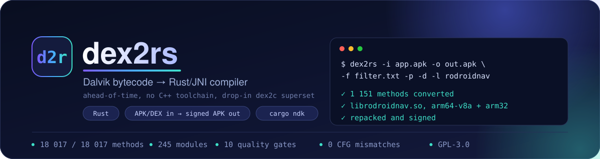
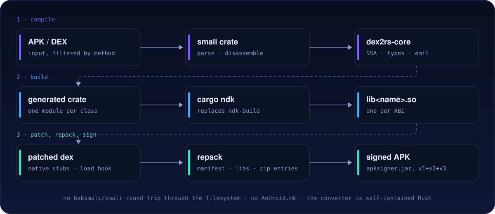
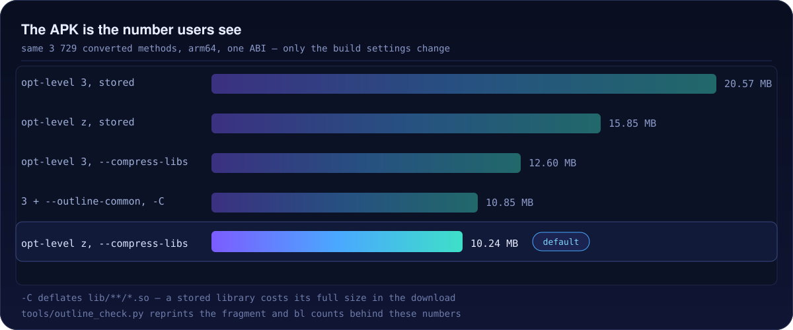
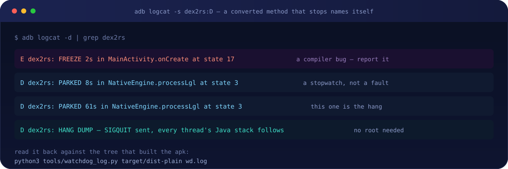

<p align="center">
  
</p>

<p align="center">
  <em>Selected methods of an Android APK or DEX, converted into Rust native code —<br>
  compiled, patched and signed in one run.</em>
</p>

<p align="center">
  <a href="LICENSE"></a>
  <a href="https://crates.io/crates/dex2rs"></a>
  <a href="https://docs.rs/dex2rs"></a>
  
  
  
  
  
</p>

<p align="center">
  <a href="https://t.me/+WmudnO0-xoNhMDQ8"></a>
  <a href="https://t.me/+QylrYL1GNsJiYjc0"></a>
  <a href="https://t.me/rodroidbugreporter_bot"></a>
</p>

---

| Jump to | | |
|---|---|---|
| [What it is](#what-it-is) | [Quick start](#quick-start) | [Why dex2rs](#why-dex2rs) |
| [Features](#features) | [Usage](#usage) | [ABIs](#abis) |
| [Size](#size) | [Packaging](#packaging) | [Quality gates](#quality-gates) |
| [Freeze triage](#troubleshooting-a-freeze-on-a-device) | [Limits](#limits) | [License](#license) · [Credits](#credits) |

## What it is

`dex2rs` converts selected methods of an Android `APK`/`DEX` into native code. The
generated code, the runtime it links against, and the tool that drives the whole
pipeline are Rust — there is no NDK build system, no baksmali/smali round trip
through the filesystem, and no C++ toolchain to configure.

It builds on the **dex2c** design (an ahead-of-time compiler that turns dex methods
into JNI functions with a small hand-written runtime) and is a drop-in,
feature-complete superset of it: the same conversion model, the same generated
structure, and the same JNI contract — with the issues that design leaves open fixed,
and with capabilities it never had. The reference implementation is only needed to
*re-run the differential checks*; the compiler itself is self-contained.

<p align="center">
  .so, then patched dex, repack and sign">
</p>

<details>
<summary>The same pipeline as text</summary>

```text
apk/dex ──▶ smali crate ──▶ dex2rs-core ─────────▶ generated Rust crate
            (parse/disassemble)  (dex2c port)        │
                                                     ▼
                              cargo ndk (replaces ndk-build/Android.mk)
                                                     │
                          patched dex ◀── APK/DEX patching + loader injection
                                                     ▼
                                       repacked APK/DEX ──▶ apksigner.jar
```

</details>

## Quick start

```bash
# toolchain
cargo install cargo-ndk
rustup target add aarch64-linux-android        # plus the other ABIs you build
export ANDROID_NDK_HOME="$HOME/android-sdk/ndk/27.3.13750724"

# build dex2rs
git clone https://github.com/rodroidil2cppdumper-source/dex2rs
cd dex2rs && cargo build --release

# convert, build, patch and sign in one run
./target/release/dex2rs -i app.apk -o app-protected.apk -f filter.txt \
       -p -d -C -k --abis arm64-v8a
```

The filter file says which methods get converted — start with the package you want to
protect:

```text
com/example/app/.*;.*          # every method whose full name matches
!com/example/app/Keep;.*       # exclusions are checked first
```

`dex2rs --help` groups every option by what it is for and prints the examples from
[Usage](#usage) underneath. The build reports what it did, per ABI:

```text
 1151 methods selected, 1151 converted
 Building out/project for arm64-v8a ...
   lib/arm64-v8a/libstub.so  2 846 888 bytes
 signed app-protected.apk (9 920 117 bytes)
```

## Why dex2rs

| | |
|---|---|
| **No toolchain to install** | `cargo ndk` replaces `Android.mk`/`Application.mk`; the `smali` crate replaces `androguard` plus the `APKEditor.jar`/`baksmali`/`smali` toolchain; only `apksigner.jar` is kept, for signing |
| **Compiles whole apps** | 18 017 of 18 017 methods of a real, obfuscated, Kotlin+Compose application, in one run |
| **Fast, incremental builds** | one module per top-level class; a cold `cargo check --release` on a 3 729-method app went from **5 m 42 s to 41 s** |
| **Real obfuscation** | `--obfuscate` encrypts string constants **and** the class/field/method names the reflection path passes — 40 530 call sites on a real app |
| **Self-diagnosing runtime** | a converted method that hangs names itself in logcat: `PARKED` (a stopwatch) vs `FREEZE` (a compiler bug), plus a `SIGQUIT` thread dump after a 60 s park |
| **Provable equivalence** | whole-app checks compare every method's control-flow skeleton and every dispatcher arm against the reference compiler, and compare `--obfuscate` against plain |

## Features

### Compiler (`dex2rs-core`)

* Full dex2c pipeline: basic blocks, dominators, exception landing pads, SSA with
  phi placement and sealing, type inference and merging, and a Rust emitter.
* Every instruction of the reference instruction set, **plus the `java.lang.invoke`
  support it never had**:
  * `invoke-polymorphic` — `MethodHandle.invoke`/`invokeExact` and every
    `VarHandle` access mode, bridged through `MethodHandle.invokeWithArguments`
    so the call site's own prototype (not the erased JNI descriptor) drives the
    boxing;
  * `const-method-handle` / `const-method-type` — including the handle *kind*
    (`static-get`, `invoke-constructor`, …) and the access-checked
    `MethodHandles.lookup()` the member needs.
* Correctness beyond the reference, each escaped by a test:
  * a catch handler is reached with the register state **at the throwing
    instruction**, not at the end of its block (the reference rewound an `int`
    where the app rewound a `ByteBuffer`);
  * type inference rules for values cast to two array types, `check-cast` over a
    sealed value, phis that merge a primitive with a reference, and arrays merged
    with `Object` — 18 017 of 18 017 methods vs the reference's 18 010;
  * numeric conversions spelled out where generated C++ relied on implicit
    conversion, so a Rust type error is never hidden by a language difference.
* One module per top-level class; anonymous and synthetic classes are folded into
  the class that declares them, so `Foo$1`, `Foo$when$0` and
  `Foo$$ExternalSyntheticLambda0` live in `Foo.rs` (488 modules → 245 on the test
  app) with no numeric-suffix file names.

### Runtime (`dex2rs-runtime`)

* Resolve caches, well-known classes, arrays, fields, calls, exceptions, casts,
  numeric conversions, and the obfuscated-string and obfuscated-name decoders.
* **Class resolution on a thread the app's own native code attached.** `FindClass`
  resolves against the *calling Java frame*; a thread with none falls back to the
  boot loader and silently fails to see the app's classes. The runtime remembers
  the first real class loader it sees and retries through it, so a converted
  method called back from the app's JNI code resolves the same classes any Java
  thread does.
* **A freeze watchdog.** Every generated entry point claims a slot with
  `d2c::watch()` for exactly as long as it is on the stack, so the runtime always
  knows *which* method a thread is inside. Two lines come out of it:
  * `E dex2rs: FREEZE in <method> at state <n>` — that arm re-enters itself
    without leaving. **A compiler bug**, logged at `error`.
  * `D dex2rs: PARKED <n>s in <method> at state <n>` — a frame that has made no
    progress. A stopwatch, not a fault: a build step that hands work to the app's
    own native library parks for tens of seconds normally.
* **A hang leaves evidence even when nobody is watching.** A park past 60 s makes
  the runtime send itself `SIGQUIT`, and ART writes every thread's Java stack into
  logcat after a `HANG DUMP` line — no root, no `kill -3` timing, no rebuild.

### CLI (`dex2rs`)

* `dcc.cfg` + d2c-style filter files, `APK` and `DEX` inputs.
* Smali patching of selected methods (`native` stubs), loader/`<clinit>`
  injection, `cargo ndk` builds, APK repacking, and signing.
* `--obfuscate`, `--dynamic-register`, custom-loader handling, ABI/license
  filtering, `--compress-libs`, and `--no-build` (generate the crate only).
* Nothing about the *conversion* depends on the build: `--no-build` produces a
  normal Cargo project you can inspect, diff, and build yourself.
* `dex2rs --help` groups every option by what it is for and prints the examples
  from [Usage](#usage) underneath.

## Hardened `--obfuscate`

The reference obfuscator was a `const fn` XOR with a **fixed key**, which only
defeats a naive `strings`: the key is in the binary too, so one known plaintext
recovers the keystream. `dex2rs` changes both halves.

**The ciphertext is generated ahead of time, with a per-constant seed.** The
generator XORs the bytes itself, so the plaintext never exists in the generated
crate, and the seed is derived from the content, so one sweep with a known key
recovers nothing and regenerating an unchanged app is byte-identical.

**The decode cannot be constant-folded.** `new_string_utf_obf_seeded` reads its
source through `core::hint::black_box` and is `#[inline(never)]`, so LLVM cannot
compute the plaintext and materialise it in `.rodata` or as immediates — the
difference between a working obfuscation and one where 695 of 1976 constants were
readable with `strings`.

**The reflection path is encrypted too.** Every class, field and method name the
generated code passes to `FindClass`/`GetMethodID` goes through `d2c::Name::obf`
instead of a plain literal:

```rust
// plain
if d2c::resolve_method(env, &mut cls4, &mut mth9, false,
        b"java/lang/Integer", b"intValue", b"()I") { break 'd2c; }

// --obfuscate
if d2c::resolve_method(env, &mut cls4, &mut mth9, false,
        d2c::Name::obf(b"\x7f\x02\x9e...", 0x91c4d70b), ...) { break 'd2c; }
```

The same pass covers the class names `check-cast` reports, the exception types a
handler matches on, the element types `new-object-array` resolves, the
descriptors and member names behind `const-method-handle`,
`const-method-type` and `invoke-polymorphic`, and — under `--dynamic-register` —
the whole `RegisterNatives` table: the class it registers against, and each
entry's method name and signature.

The signature has to go through the same pass because `RegisterNatives` builds
the call from it, and that signature is a JNI descriptor — so `(Lb0/d0;)V` names
the app's own parameter and return classes. A table of C-string literals therefore
handed back the very names being hidden, and did: on a `--obfuscate
--dynamic-register` build, `tools/verify.py` found 182 app class names in
`libstub.so` with everything else encrypted. The generated table now holds
`d2c::ObfMethod`s, and `register_natives_obf` decodes each entry into owned
storage for the length of the registration call — ART reads the array during the
call and keeps only the function pointers — so nothing plaintext is left in
`.rodata`. The reflection names are decoded on the failure path only, so a cast
that succeeds pays nothing.

On the test app that is **113 919 name sites** across **245 modules**, 1976 string
constants, and the **3 729-entry** register table. `tools/obf_equiv.py` requires
the obfuscated build to be *identical to the plain one* once both are
canonicalised — every name and string decrypting back to its plaintext at the call
site the plain build has it, and the decoded register table equalling the plain
table entry for entry.

## Requirements

* Rust 1.85+ (edition 2024), and one of:
  * `cargo install dex2rs` — the crates.io release, or
  * a checkout, with `cargo build --release`
* `cargo-ndk` (`cargo install cargo-ndk`)
* The Android NDK, exported as `ANDROID_NDK_HOME` — or set `ndk_dir` in `dcc.cfg`,
  which is handed to the build as `ANDROID_NDK_HOME`/`ANDROID_NDK_ROOT`. An empty
  value means "let `cargo-ndk` find it"
* Rust targets for the ABIs you build, e.g.
  `rustup target add aarch64-linux-android armv7-linux-androideabi`
* `java` on `PATH` for signing. `apksigner.jar` and the Android debug keystore are
  embedded in the binary, so an installed `dex2rs` signs without a checkout; a
  `tools/apksigner.jar` next to the executable (or `DEX2RS_TOOLS`) overrides the
  jar, and `keystore_path` in `dcc.cfg` overrides the key. That default points at
  `keystore/debug.keystore` in the working directory; the repository does not ship
  one, so when it is absent the embedded key is used and there is nothing to create

## Usage

```bash
# 1. The normal run: convert, build, patch, sign.
dex2rs -i app.apk -o app-converted.apk -f filter.txt

# 2. Everything the protection has, for one device ABI, smaller library:
dex2rs -i app.apk -o app-protected.apk -f filter.txt \
       -p -d -C -k --abis arm64-v8a --opt-level z

# 3. Sources only, no NDK build:
dex2rs -i app.apk -f filter.txt -b -e out/project -z out/project.zip

# 4. ...and later, pack the library that project built, without rebuilding it:
dex2rs -i app.apk -o app-protected.apk -f filter.txt -b -e out/project

# 5. A custom library name and loader class, for two ABIs:
dex2rs -i app.apk -o app-protected.apk -f filter.txt -l rodroidnav \
       -r -c com.example.Loader -k --abis arm64-v8a,armeabi-v7a
```

| Option | Meaning |
|---|---|
| `-i, --input` | input `.apk` or `.dex` |
| `-o, --output` | output path (`output.apk` / `output.zip` by default) |
| `-f, --filter` | filter file: which methods get converted (see [Filters](#filters)) |
| `-p, --obfuscate` | encrypt string constants **and** reflection names |
| `-d, --dynamic-register` | export natives via `RegisterNatives` instead of symbols |
| `-c, --custom-loader` | loader class to install, dotted name (default `amimo.dcc.DccApplication`) |
| `-r, --force-custom-loader` | install that loader class even when the app has its own `Application` |
| `-s, --skip-synthetic` / `-a, --allow-init` | method selection |
| `-l, --lib-name` | library name: the output is `lib<NAME>.so` and the hook loads `<NAME>` (default `stub`) |
| `-e, --source-dir` | where the generated crate is written (reused if present) |
| `-b, --no-build` | pack a library left in `libs/`; with none, write the sources and zip them (see below) |
| `-z, --project-archive` | where a `-b` run with no library zips the sources |
| `-k, --force-keep-libs` | build exactly the ABIs in `--abis`, ignoring the ones the APK ships |
| `-C, --compress-libs` | deflate `lib/**/*.so` and set `extractNativeLibs="true"` |
| `--opt-level` | `opt-level` of the generated library: `z` (default) or `3` |
| `--outline-common` | force LLVM's machine outliner on at `opt-level 3` |
| `--abis` | ABIs to build, **comma-separated**; without it, the list in `dcc.cfg` |
| `--api` | API level for the build (default: the input's `minSdkVersion`) |
| `--keep-debug-info` | keep the dex debug tables (dropped by default) |
| `--trace` | compile per-instruction tracing into the generated code |
| `--config` | defaults file (default `dcc.cfg`) |

### Compression

`--compress-libs` is the one packaging choice with a matching manifest flag, so it
changes both: the libraries move from "mapped out of the APK" to "unpacked by the
installer". Leaving the pair inconsistent installs cleanly and then fails to load
the library, so `tools/verify.py` checks the two together rather than either one
alone. It moves the APK by more than `opt-level` does — see
[Packaging](#packaging).

### ABIs

`--abis` takes one comma-separated list — `--abis arm64-v8a,armeabi-v7a`, not a
repeated flag. Which list wins depends on whether the APK ships libraries of its
own and on `-k`:

| case | ABIs built |
|---|---|
| `-k` | the `--abis` list, whatever the APK ships |
| no `-k`, APK ships libraries | the APK's ABIs; `--abis` is ignored |
| no `-k`, APK ships none | the `--abis` list |

With neither, the `abis` list in `dcc.cfg` is used (`arm64-v8a,armeabi-v7a` in
this repository).

```bash
dex2rs -i app.apk -o app.apk -f filter.txt -k --abis arm64-v8a,armeabi-v7a
```

All four ABIs dex2rs knows are buildable — the NDK ships `i686` and `x86_64`
toolchains next to the arm ones — and each name maps to one rust target:

| ABI | rust target | bitness | runs on |
|---|---|---|---|
| `arm64-v8a` | `aarch64-linux-android` | 64-bit ARM | every phone since about 2015 |
| `armeabi-v7a` | `armv7-linux-androideabi` | 32-bit ARM | older and 32-bit-only devices |
| `x86_64` | `x86_64-linux-android` | 64-bit Intel/AMD | emulator images on Intel/AMD hosts, Chromebooks (ARC) |
| `x86` | `i686-linux-android` | 32-bit Intel | old Intel phones and old emulator images |

```bash
rustup target add aarch64-linux-android armv7-linux-androideabi \
                  x86_64-linux-android i686-linux-android
```

**A device loads exactly one slice.** Android picks the one matching the device's
primary ABI (`ro.product.cpu.abi`, e.g. `arm64-v8a`) and ignores the others, which is
why building a single `arm64-v8a` is enough to test on a modern phone: the other
slices in the output are inert there. If the device's ABI is missing, the converted
methods have no implementation and the library cannot load at all — `verify.py`
reports it as `lib/<abi>/lib<name>.so is missing for abi <abi>` rather than passing
silently. Build every ABI the app ships if it has to run everywhere.

**Why `x86` and `x86_64` are usually left out.** Most apps carry those two slices for
one small dependency that publishes them — on the reference app it is
`libandroidx.graphics.path.so`, 9 KB for `x86` and 10 KB for `x86_64` — not because the
app supports Intel hardware. That app's own JNI library is 4.9 MB of arm-only code, so
it cannot run on an x86 device in the first place: `System.loadLibrary` fails before a
single converted method is reached, and adding an x86 slice of the converted code would
not change that. The 32-bit `x86` slice is the one to skip outright: only old Intel
phones and old emulator images use it, and Google Play has required a 64-bit slice since
2019. Build `x86_64` when you test in an emulator on an Intel or AMD host:

```bash
dex2rs -i app.apk -o app.apk -f filter.txt -k --abis arm64-v8a,x86_64
```

### Library name and loader

`-l` renames the library and the call that loads it together, so the two cannot
drift apart: the output is `lib<NAME>.so` (`libstub.so` by default,
`librodroidnav.so` below) and the injected hook becomes
`System.loadLibrary("<NAME>")`.

```bash
dex2rs -i app.apk -o app.apk -f filter.txt -l rodroidnav      # librodroidnav.so
```

The hook is written into the app's own `Application` class' `<clinit>` when the
app has one, which leaves `android:name` — and the app's own initialisation —
untouched. When the app has no `Application` class, the tool adds a loader class
(`-c, --custom-loader`, default `amimo.dcc.DccApplication`) and points
`android:name` at it. That class extends `android.app.Application` and loads the
library from its own `<clinit>`:

```smali
.class public Lcom/example/Loader;
.super Landroid/app/Application;

.method static final constructor <clinit>()V
    .locals 1
    const-string v0, "rodroidnav"
    invoke-static {v0}, Ljava/lang/System;->loadLibrary(Ljava/lang/String;)V
    return-void
.end method
```

`-r, --force-custom-loader` takes that loader-class route even when the app has
its own `Application`: the class is installed and instantiated from the app
class' `<clinit>`, which triggers the load. Nothing else about the manifest
changes.

```bash
# own library name, own loader class, two ABIs
dex2rs -i app.apk -o app-protected.apk -f filter.txt \
       -p -d -l rodroidnav -r -c com.example.Loader -k --abis arm64-v8a,armeabi-v7a
```

With `--dynamic-register` the library name reaches nothing else: the methods are
bound in `JNI_OnLoad` and are not exported under JNI long names, so no symbol
depends on it.

### `--no-build`, and when it refuses

`-b` is the one path where the dex and the library can disagree: the dex is
patched from the methods compiled *now*, while the library is whatever `libs/`
happens to hold. Two checks keep that from reaching a phone:

* **A library this tool built is checked.** A successful build records a
  fingerprint of the sources it compiled (`libs/.dex2rs-sources`). If a later
  `-b` has different sources — a new filter, an `--opt-level` change, a converter
  fix — it stops rather than patching the dex for one set of methods while
  shipping a library for another:

  ```
  error: the libraries in out/project/libs were built from different sources
  (3c09888833a2d1e5) than the ones generated now (91b0f2c4a8e17d33): ...
  Re-run without --no-build to rebuild them, or delete out/project/libs to build from scratch.
  ```

  A library built by hand has no fingerprint; that is reported as "packed without
  checking", not treated as a match.
* **ABIs are not all-or-nothing.** `-b` packs every ABI that has a library and
  names the ones that do not, instead of reporting "no libraries" — the input APK
  advertises four ABIs, and building one for your own device is the normal case.

With no library at all, the output is an artifact to inspect, not to install, and
the run says so and points at the two ways to finish.

### Filters

Filter files keep the `d2c` syntax:

```
# comment
.*                        # include methods whose full name matches
!Lcom/example/Foo;.*      # never compile these (checked first)
=Lcom/example/Hello;add(II)I   # exact match; the full name is
                               # `class` + `name` + `proto` concatenated
```

A file with no uncommented rule converts nothing, which produces an APK whose
methods are untouched and a library with nothing registered against it.

## Size

<p align="center">
  
</p>

Nearly all of a converted library is `.text`. The numbers below are one generated
tree — 3 729 methods, `--obfuscate --dynamic-register`, arm64, API 26, one ABI,
`lto = true`, `codegen-units = 1`, `panic = "abort"`, stripped: no `.symtab`, no
`.debug_*`, 1.4 KB of `.dynsym`:

| build | `libstub.so` | `.text` | `.eh_frame` | functions | build time |
|---|---|---|---|---|---|
| `opt-level 3` | 12.37 MB | 11.22 MB | 0.29 MB | 4 431 | 3m 46s |
| `3`, inliner disabled | 11.02 MB | 9.90 MB | 0.27 MB | 4 485 | 3m 01s |
| `3` + `--outline-common` | 8.81 MB | 6.76 MB | 0.93 MB | 36 594 | 3m 42s |
| **`opt-level z`** (default) | **7.64 MB** | **5.74 MB** | 0.82 MB | 36 471 | **3m 01s** |
| `2` | 12.67 MB | 11.54 MB | 0.28 MB | — | — |
| `s` | 13.20 MB | 12.09 MB | 0.29 MB | — | — |

Build times are cargo's own, one ABI, same tree, separate target directories.

`opt-level` is not a dial: `2` and `s` measure *larger* than `3`, and the
difference between `3` and `z` is one pass. Disabling the inliner at `3`
(`-C llvm-args=--inline-threshold=0`) removes 1.32 MB of the 4.73 MB and leaves
the function count at 4 485, so inlining is not the cause; the rest is **LLVM's
machine outliner**, which `z` runs as part of size-first code generation and `3`
does not. It finds short instruction sequences repeated up to thousands of times,
keeps one copy of each and puts a `bl` at every site; asking for it at `3` is what
`--outline-common` does. Its price is `.eh_frame`, which grows 0.29 → 0.93 MB
because every fragment needs unwind info: `.text` −4.46 MB, `.eh_frame`
+0.64 MB, file −3.56 MB.

Both settings change only how the generated Rust is compiled, never what is
generated — `tools/cfg_diff.py` and `tools/arm_check.py` read the generated
source, not the object code, and are unaffected. The setting is per run: pass
`--opt-level` / `--outline-common`, or declare `"opt_level"` / `"outline_common"`
in `dcc.cfg`, which is what makes it stick; the CLI wins over the file.

Measured on the outlined build — 1 690 236 instructions of `.text` — the outliner
produced:

| | |
|---|---|
| fragments created (`≤32 B`) | 30 066 |
| instructions inside them | 121 116 — **7.2% of `.text`** |
| `bl` sites that call them | **447 761** |
| call sites per fragment | median 5, p90 19, max 8 291 |
| fragments nothing calls | 103 (0.3%) |

`tools/outline_check.py` prints that table for any built `.so` and disassembles
the fragments with the most call sites, which are Rust runtime helpers rather
than dispatcher prologues:

| sites | fragment |
|---|---|
| 8 291 | `ldr x8,[x20]; mov x0,x20; ldr x8,[x8,#0x720]; br x8` — virtual call |
| 7 652 | `ldr x8,[x8,#0xb8]; br x8` — another vtable slot |
| 7 557 | `mov x1,x0; cmp x0,#1; ret` — discriminant test |
| 3 706 | `ldxr x9,[x10]; add x11,x9,#1; stxr w12,x11,[x10]; ret` — `Arc::clone` |

## Packaging

The number users see is the APK. Same tree, same 3 729 methods, arm64:

| build | `libstub.so` in the APK | APK |
|---|---|---|
| `opt-level 3`, stored | 12.37 MB stored | 20.57 MB |
| `opt-level 3`, `--compress-libs` | 4.40 MB deflated | 12.60 MB |
| `opt-level 3 --outline-common`, `--compress-libs` | 4.71 MB deflated | 10.85 MB |
| `opt-level z`, stored | 7.64 MB stored | 15.85 MB |
| **`opt-level z`, `--compress-libs`** (default) | **4.10 MB deflated** | **10.24 MB** |

* **A stored `.so` costs its full size.** `extractNativeLibs="false"` is what a
  modern app ships, and it requires `Stored`, so the converted code is paid for
  byte for byte in the download — 7.6-12.4 MB on this app. `-C` moves the same
  object down to ~4.1 MB.
* **Compression narrows the `opt-level` gap.** `z` halves `.text`, but it also
  removes the redundancy deflate was exploiting, so the compressed ratio goes
  from 35.6% to 53.6%: the raw 4.7 MB gap between `3` and `z` becomes 2.4 MB in
  the APK.
* **The outlined build is incompressible.** Its fragments are as deflate-resistant
  as `z`'s own code (53.4% against 53.6%), which is why removing 4.46 MB of raw
  `.text` moves the APK by 1.75 MB.

For scale, the reference input app is 8.4 MB and its `classes.dex` shrinks from
4.44 MB to 3.99 MB raw as methods move out of it. Adding 3 729 converted methods
as 7.6 MB (`z`) or 12.4 MB (`3`) of native code on top is the conversion's real
cost, not overhead: it is the price of having the methods exist in native form at
all. Nothing here is untrimmed — see [Size](#size) for the strip/`.dynsym`
numbers.

## Generated crate

`-e out/project` produces a normal Cargo project:

```text
out/project/
├── Cargo.toml          # cdylib, `[lib] name = <--lib-name>`
├── runtime/            # the dex2rs-runtime this build links (a copy, written
│                       # from the runtime crate itself, so it is the code the
│                       # CLI was built against)
└── src/
    ├── lib.rs          # JNI_OnLoad: cache classes, then register if dynamic
    ├── methods.rs      # module root: `pub mod` + `pub use` per class
    ├── methods/        # one entry point per compiled method, one file per class
    └── dynamic_register.rs
```

`cargo ndk -t <abi> -o libs build --release` (what the CLI runs) produces
`libs/<abi>/lib<name>.so`; no `Android.mk`/`Application.mk` is involved.

`-z` zips that tree for a machine without the NDK. It packs the sources — the
manifest, `runtime/`, `src/`, and `Cargo.lock` — and leaves out `target/` and
`libs/`: build output is not source, and a cargo target directory is gigabytes
(7.4 GB in this repository alone).

Type-checking all 18 017 methods of the test app in one crate peaks at ~2.9 GB of
RSS, which is why a whole-app build wants a machine with headroom (or the crate
split further, one crate per class).

## Quality gates

Everything below is runnable on a generated build. The one-command entry point is:

```bash
tools/check_all.sh out.apk --source-dir target/prod --original app-release.apk
```

It finds the generated crate itself (or takes `--source-dir`), picks the right
checks for the build it is looking at, runs the selftests of the tools, prints one
summary, and exits non-zero if anything failed. Checks whose inputs are missing
are reported as `SKIP`, not `PASS`, so a partial run cannot look clean.

| Check | What it proves |
|---|---|
| `tools/cfg_diff.py` | the branch/exit skeleton of every method equals the reference compiler's — the bug class that hangs an app |
| `tools/arm_check.py` | every dispatcher arm leaves its state on every path (18 900 arms on the test app; it fails when it inspects zero) |
| `tools/monitor_check.py` | no path leaves a method still holding a monitor |
| `tools/exception_check.py` | every landing pad takes the pending exception first (a handler that does not runs with it still set, and an app-level retry loop repeats forever) |
| `tools/obf_equiv.py` | `--obfuscate` changes only the string call, the name call, the register-table entry form and the export attribute — every ciphertext decrypts to its plaintext, and the decoded `RegisterNatives` table equals the plain one entry for entry |
| `tools/register_check.py` | every signature in `dynamic_register.rs` decodes to the entry point it points at, and every table's registered class (plaintext or decrypted) is the one its comment names |
| `tools/host_jvm_check.sh` | the runtime helpers against a real desktop JVM, under `-Xcheck:jni` (cast rules, exception dispatch, resolved calls, obfuscated round trips, `RegisterNatives`) |
| `tools/watchdog_log.py` | a logcat capture, read back against the generated tree: which arm each report names, and whether it is a park or a compiler bug |
| `tools/verify.py` | the APK itself: dex/manifest patching, signing, ELF per ABI, the loader hook, that a pre-existing native keeps the library that declared it (or is reported lost), and that `--obfuscate` left no app class name in the library |
| `tools/outline_check.py` | what the machine outliner did to a built `.so` — the fragment and `bl` counts behind the [Size](#size) tables, so those numbers are measured rather than parsed by hand |

Two whole-app checks compare against the reference compiler (clone it next to this
tree to re-run them):

```bash
git clone https://github.com/Kirlif/d2c d2c
tools/make_reference.sh app-release.apk target/golden filter.txt   # ~35 s
python3 tools/cfg_diff.py target/golden/jni/nc target/dist-prod/src/methods
```

`make_reference.sh` patches two things in a *copy* of the reference: it refuses
any method whose JNI name passes 220 characters (a filename limit; names here
reach 505), so `$default` bridges, the large Kotlin lambdas and the service entry
points have no reference at all, and its files are named `m#####.cpp` with an
`index.tsv`. Nothing about the emitted code changes, so it is still the reference
compiler's output.

`cfg_diff.py` reads Rust source as text, so its parser is load-bearing: a
ciphertext byte can be `{` or `}` under `--obfuscate`, and counting those as code
braces once reported **41 control-flow mismatches that did not exist**. Literals
and comments are blanked before anything counts braces, and
`python3 tools/cfg_diff.py --selftest` pins both halves.

## Troubleshooting a freeze on a device

<p align="center">
  
</p>

Generated code has no source-level debugging, so the useful signal is its own
report. A normal (non-`--trace`) build already writes it; `--trace` compiles the
per-instruction `LOGD`-equivalent back in when you need the exact instruction:

```bash
dex2rs -i app.apk -o traced.apk -f filter.txt --trace   # no --no-build!
adb install -r traced.apk && adb logcat -c
adb logcat -s dex2rs:D > trace.txt &
# launch the app, wait for it to freeze, then:
tail -200 trace.txt
```

Every line carries the method and the instruction index being executed:

```text
-> Java_com_example_MainActivity_onCreate__Landroid_os_Bundle_2
[Java_..._onCreate__Landroid_os_Bundle_2] 0:invoke-super ...
[Java_..._onCreate__Landroid_os_Bundle_2] 6:invoke-static ...
```

A spinning method shows up as an unbounded repetition of one instruction, and the
`-> ` lines above it are the call chain — enough to name the method and the exact
basic block.

For a normal build, grep for the tag (not for `FROZEN|STUCK`, which misses
`FREEZE`) and read the capture back against the tree that produced it:

```bash
adb logcat -d | grep dex2rs > wd.log
python3 tools/watchdog_log.py target/dist-plain wd.log
```

The tool prints the arm each reported state owns and classifies it: `FREEZE` is
the only line that means the compiler produced a loop (report it with the app it
came from), `PARKED` is a stopwatch — a line whose seconds keep climbing with
nothing after it is a hang and names the call it is waiting in, and the 60 s
`HANG DUMP` that follows carries every thread's Java stack. `IMPOSSIBLE` and
`STALE` mark reports from trees older than the current guard.

## Limits

Every remaining refusal names the instruction and the reason, and each was
measured — `dex2rs --example op_dump -- <dex> <filter>` prints the exact `DexOp`
the front-end produced:

* **`invoke-custom`** needs the call site's *static arguments* (the
  `call_site_item` array), which this front-end does not carry: a
  `StringConcatFactory` recipe or a `LambdaMetafactory` `samMethodType` is what
  the bootstrap builds the target from, so lowering the instruction without them
  would emit a call site that does something else. D8 desugars both string
  concatenation and lambdas at every `--min-api`, so this only appears in
  `--no-desugaring` output: an app built normally converts 100%.
* **`execute-inline` / `execute-inline/range`** are quickened opcodes that exist
  only in an on-device optimised dex/vdex, never in a shipped APK's `.dex`.

## Publishing

Three crates go to crates.io, and the order is not a preference: cargo resolves
each crate's version requirements against the registry, so a dependent cannot be
*packaged* — let alone published — while the crate below it is unpublished. A `v*`
tag runs [`.github/workflows/publish.yml`](.github/workflows/publish.yml), which
publishes in that order and waits for each version to reach the sparse index before
starting the next:

```bash
cargo publish -p dex2rs-runtime    # the runtime a generated project links against
cargo publish -p dex2rs-core       # the converter
cargo publish -p dex2rs            # the CLI
```

By hand that is those three commands, in that order, from a clean tree, after
`cargo test --workspace`. Everything the CLI needs at run time travels in its own
tarball — the scaffolding template, `apksigner.jar` and the debug keystore are in
the package, and the runtime sources it vendors come from `dex2rs-runtime` itself —
so `cargo install dex2rs` works with no checkout and no `DEX2RS_*` variables. Every
push checks that: a full `cargo publish --dry-run` for the leaf crate, and the file
list for the two that depend on it.

docs.rs builds each crate as soon as its version is live, with **every feature
enabled** (the `trace` hooks are `cfg`-gated and would otherwise be missing from
the documentation). The same rustdoc also goes to GitHub Pages from
[`.github/workflows/docs.yml`](.github/workflows/docs.yml); enable Pages with
"GitHub Actions" as the source once and that is automatic.

## License

**GNU General Public License v3.0** — the verbatim text is in [`LICENSE`](LICENSE),
and the manifests declare the SPDX id `GPL-3.0-only`.

The license covers this repository: the converter (`dex2rs-core`), the runtime
(`dex2rs-runtime`) and the CLI (`dex2rs`). Distribute dex2rs, or a modified
dex2rs, and the GPL applies to it: recipients get the same freedoms and are
entitled to the corresponding source.

> [!IMPORTANT]
> The runtime is **compiled into** the `lib<name>.so` inside a converted APK — that
> APK therefore ships GPL-licensed code, not merely GPL-produced output. Read
> strictly, redistributing such an app means being able to hand its recipients the
> corresponding source for the GPL part: the generated crate and the `runtime/`
> directory in it. Building for your own device, or keeping the result to yourself,
> triggers nothing.
>
> If you would rather that not be the case, the two established fixes are a linking
> exception granted by this project for generated output, or a permissive license on
> `dex2rs-runtime` alone. Either is one file plus a manifest line.

This section describes how the project reads its own license; it is not legal
advice.

## Credits

Built and maintained for the **Rodroid Mods** community.

* Repository: <https://github.com/rodroidil2cppdumper-source/dex2rs>
* Channel: <https://t.me/+WmudnO0-xoNhMDQ8>
* Group: <https://t.me/+QylrYL1GNsJiYjc0>
* Report bugs: <https://t.me/rodroidbugreporter_bot>

The conversion model and the differential reference come from the **dex2c**
project (<https://github.com/Kirlif/d2c>, Apache-2.0); this implementation shares
none of its code and keeps the reference only for the whole-app comparison checks.

<p align="center">
  
</p>
